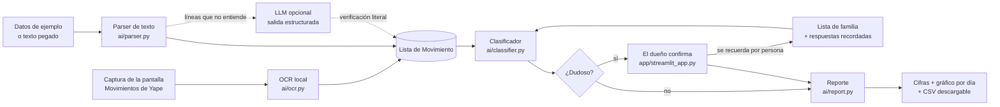

# Pipeline de Yape Contable

Qué ocurre, paso a paso, desde que el comerciante sube una captura hasta que ve su reporte. Cada paso indica el archivo y la función que lo hace.

## 1. Vista general

Idea central: **un movimiento solo se clasifica solo si hay una pista; si no, se le pregunta al dueño y se recuerda su respuesta.** El programa no adivina quién es cliente y quién es familia.

## 2. El dato que circula: `Movimiento`

Definido en `ai/parser.py`. Todos los orígenes (captura, texto, LLM) terminan en la misma estructura:

| Campo | Ejemplo | Nota |
|---|---|---|
| `fecha` | `16/11/2026` | DD/MM/AAAA |
| `hora` | `14:24` | 24 h |
| `tipo` | `enviado` / `recibido` | rojo con "-" en la captura = enviado |
| `contraparte` | `Rosa Quispe` o `(sin nombre)` | nombre tapado o ilegible = `(sin nombre)` |
| `monto` | `34.0` | siempre positivo |
| `nota` | `Recibiste un PLIN` | texto después de la hora, si lo hay |

## 3. Paso a paso

### Paso 0 — Leer la captura (`ai/ocr.py`)
1. `leer_captura()` corre **RapidOCR** (modelo ONNX, sin API externa) y devuelve cada texto con su posición `(x, y)`. Descarta lecturas con confianza < 0.4.
2. `parsear_items()` reconstruye las filas a partir de las posiciones:
   - **Monto:** texto a la derecha (x ≥ la mitad del ancho) que cumple `[-]S/ número`. Cada monto es el ancla de una fila; el signo "-" significa *enviado*.
   - **Fecha y hora:** el texto de la izquierda ubicado unos 22 px debajo del monto. Entiende `Ayer 1:52 pm` y `15 nov. 2026 - 6:15 pm`. "Ayer" se calcula con el día que el usuario indica en la barra lateral.
   - **Nombre:** el texto de la izquierda que está encima del monto. Si no hay (nombre tapado), queda `(sin nombre)`.
   - **Nota:** lo que sigue a la hora (por ejemplo `Recibiste un PLIN`).
3. Las regex toleran que el OCR pierda espacios (`Ayer1:52pm`, `-S/255.00`).

### Paso 0b — Leer texto (`ai/parser.py`)
Para el origen "Datos de ejemplo" o "Pegar texto":
- `parse_rules()` usa una regex para el formato `DD/MM/AAAA HH:MM | recibido|enviado | Nombre | S/ monto | nota`.
- Las líneas que no entiende se devuelven como "pendientes".
- Si el usuario activa el LLM, `parse_llm()` intenta leer solo esas líneas con **salida estructurada** (tool use). Luego aplica una **verificación literal**: el nombre que devuelve el LLM debe aparecer textualmente en el texto original, o se descarta (el LLM no puede inventar personas). *Está escrito pero no se ha probado contra la API real.*

### Paso 1 — Clasificar (`ai/classifier.py`, `clasificar()`)
Para cada movimiento, se aplica **la primera regla que coincida**, en este orden:

| # | Regla | Resultado |
|---|---|---|
| 1 | El dueño ya respondió por esta persona (`clave_label`) | lo que respondió |
| 2 | El nombre está en su lista de familia | `personal` |
| 3 | La nota tiene palabras personales (mamá, cine, regalo...) | `personal` |
| 4 | Enviado + nota de gasto (proveedor, mercadería...) | `gasto_negocio` |
| 5 | Recibido + nota de venta (pan, almuerzo, pedido...) | `venta` |
| 6 | Recibido, mismo nombre ≥ 3 veces, monto ≤ S/ 60 | `venta` (parece cliente) |
| 7 | Ninguna | `dudoso` |

Cada fila guarda también el **motivo** ("la nota 'pan' parece una venta"), para poder explicar por qué se clasificó así.

**Detalle importante:** `clave_label()` recuerda la respuesta *por persona*, salvo que no haya nombre. En ese caso la clave incluye fecha y hora, para que contestar un movimiento sin nombre no marque por error a todos los demás sin nombre.

### Paso 2 — Confirmación del dueño (`app/streamlit_app.py`)
- Los movimientos `dudoso` aparecen en una tabla editable.
- Hay **sugerencias ya puestas**: lo recibido viene como `venta`, y un selector "Atajo para lo que ENVIASTE" rellena todos los envíos de una vez (personal o gasto). Son suposiciones; el dueño las corrige.
- Al presionar "Aplicar mis respuestas", se guardan en `st.session_state.labels` y se vuelve a clasificar. Las respuestas viven en la sesión: no se guardan en disco.

### Paso 3 — Reporte (`ai/report.py`)
- `resumen()` suma: **ventas**, **gastos del negocio**, **utilidad = ventas − gastos**, **personal (excluido)** y cuántos quedan dudosos.
- `por_dia()` arma la tabla de ventas y gastos por día para el gráfico.
- La app permite descargar el resultado clasificado en CSV.

## 4. Decisiones y descartes

| Decisión | Por qué | Se descartó |
|---|---|---|
| OCR (RapidOCR) en vez de un LLM con visión | No requiere clave ni pago; corre dentro de la app; es la herramienta del curso (Document AI) | API de visión de un LLM: exige clave de pago |
| Reglas para clasificar | Se pueden explicar con el "motivo"; no hay datos para entrenar | Entrenar un modelo: no hay datos etiquetados |
| Preguntar cuando no se sabe | Solo el dueño sabe quién es cliente | Que el programa adivine todo: daría números falsos |
| Memoria por persona | Reduce preguntas con el tiempo | Preguntar siempre lo mismo |
| LLM opcional y con verificación literal | Que no invente nombres | Aceptar su JSON sin comprobar |
| Subir contactos del celular | Los nombres de Yape no siempre coinciden con los guardados; privacidad | Se dejó como trabajo futuro |

## 5. Cómo se probó

- **Pruebas automáticas** (`tests/test_core.py`, 7 pruebas): lectura de texto, clasificación, memoria por persona, lista de familia, resumen, y lectura de filas del OCR (con los textos que devolvió el OCR sobre una captura real, sin subir la imagen).
- **Una captura real propia** (nombres tapados): los 11 movimientos se leyeron con monto, signo, fecha y hora correctos.
- **Datos sintéticos** (`data/make_synthetic.py`): 380 movimientos (60 días) de una bodega inventada.

## 6. Límites que conviene decir con honestidad

- **Sigue habiendo trabajo manual.** Sin nombres ni notas, todo sale `dudoso`. Se reduce, no desaparece.
- Los datos sintéticos se generaron con las mismas palabras que usa el clasificador, así que su porcentaje de aciertos **no mide** el desempeño real.
- El OCR se probó con **una** captura.
- El ahorro de tiempo es una **hipótesis** (los entrevistados dedican 2 a 5 horas al mes); no se ha medido.
- En la URL pública la captura se procesa en el servidor de Streamlit; solo deben subirse capturas de ejemplo o con nombres tapados.
- El LLM no se ha probado contra la API real.

## 7. Preguntas probables y cómo responderlas

- **¿Cómo sabe si un pago es venta o personal?** No lo sabe: sigue 7 reglas en orden y, si ninguna aplica, pregunta. Cada resultado trae su motivo.
- **¿Qué pasa si el OCR se equivoca?** Hoy no hay corrección dentro de la app: se vería un monto o fecha mal. Se probó con una captura; falta probar con más.
- **¿Dónde está el modelo de IA?** En el OCR (RapidOCR) y, de forma opcional, en el LLM que ordena texto. La clasificación es por reglas, a propósito.
- **¿Por qué no usar un LLM para clasificar?** Porque necesitaría saber quién es cliente, y eso solo lo sabe el dueño; además las reglas son explicables.
- **¿Cuánto cuesta por usuario?** Casi nada hoy (OCR local, reglas); el LLM, si se usa, solo en líneas no reconocidas. No está medido todavía.
- **¿Y si el comerciante usa también Plin u otra app?** La captura de Plin trae el mismo tipo de pantalla, pero no se ha probado.
